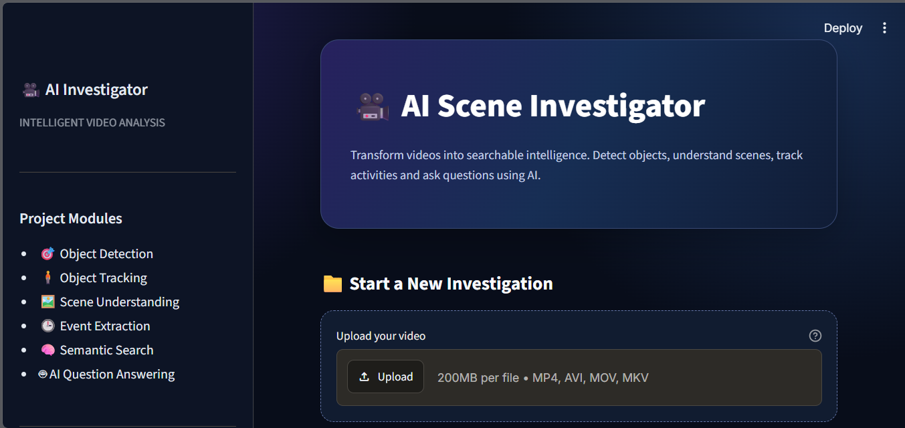
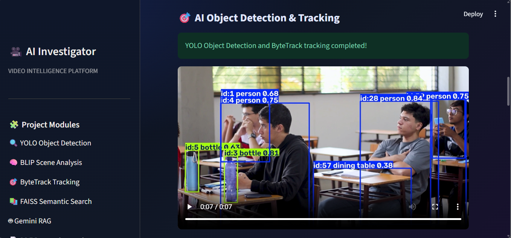
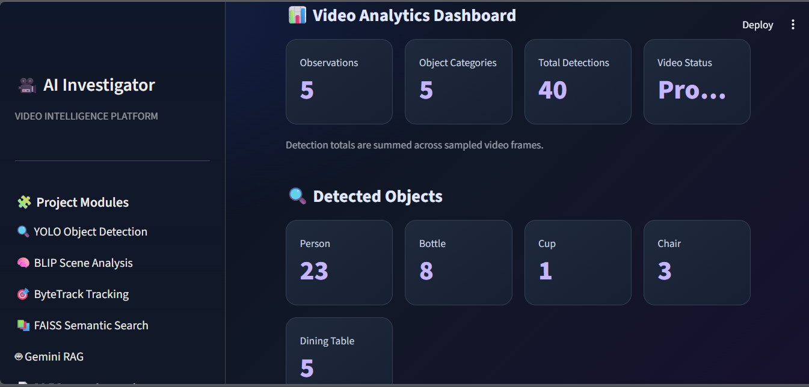
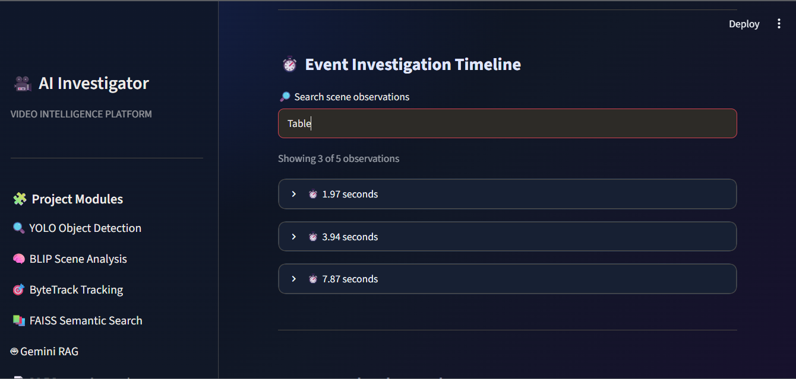
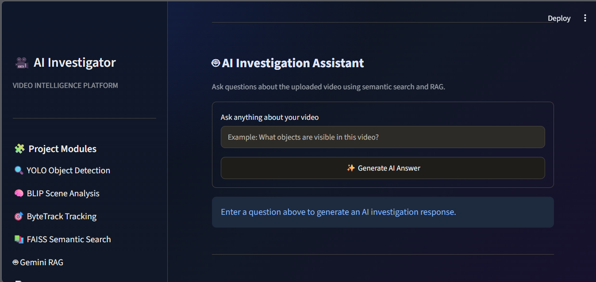
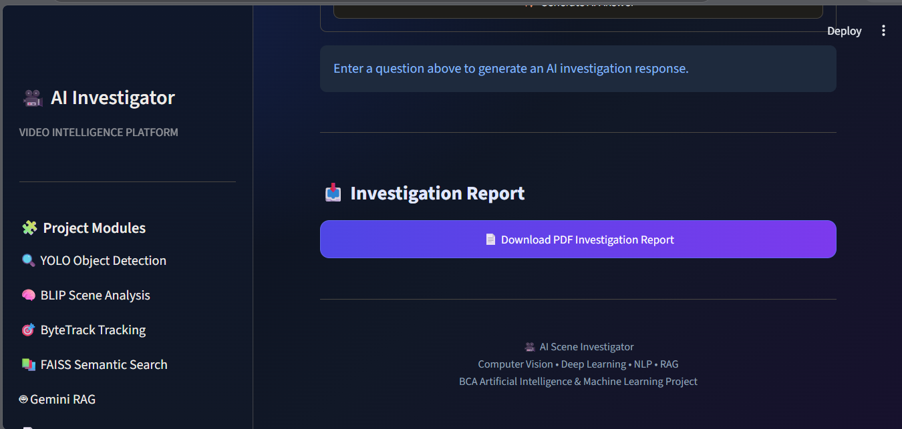

# 🎥 AI Scene Investigator

### AI-Powered Video Analysis & Intelligent Investigation System

<p align="center">
  
  
  
  
  
  
</p>

AI Scene Investigator is a Python-based intelligent video investigation application that combines computer vision, object detection, scene understanding, semantic search, and Retrieval-Augmented Generation (RAG).

The system analyzes uploaded video footage, identifies objects, tracks their movement, extracts meaningful scene observations, and allows users to investigate video content through natural-language questions.

It provides an interactive Streamlit dashboard with video analytics, event timelines, AI-powered question answering, and downloadable PDF investigation reports.

---

## 🚀 Key Features

- 🎥 **Video Processing:** Upload and analyze video footage.
- 🎯 **Object Detection:** Detect objects using YOLOv8.
- 🔍 **Object Tracking:** Track detected objects using ByteTrack.
- 🖼️ **Scene Understanding:** Generate scene descriptions using BLIP.
- 📋 **Event Extraction:** Extract structured observations with timestamps.
- 🧠 **Text Embeddings:** Convert observations into semantic vectors.
- 🗄️ **Vector Database:** Store and retrieve information using FAISS.
- 🔎 **Semantic Search:** Find relevant events using natural-language queries.
- 🤖 **AI Investigation Assistant:** Ask questions about analyzed videos using RAG.
- 🔄 **Hybrid AI System:** Gemini integration with an offline fallback.
- 📊 **Video Analytics:** Explore detection statistics and investigation insights.
- ⏱️ **Event Timeline:** Browse extracted observations and timestamps.
- 📄 **PDF Reports:** Generate downloadable investigation reports.

---

## 🛠️ Technology Stack

| Technology | Purpose |
|---|---|
| Python | Core programming language |
| Streamlit | Interactive web dashboard |
| OpenCV | Video processing and frame extraction |
| YOLOv8 | Object detection |
| ByteTrack | Object tracking |
| BLIP | Image captioning and scene understanding |
| Hugging Face Transformers | Deep learning model support |
| Sentence Transformers | Semantic embeddings |
| FAISS | Vector similarity search |
| Google Gemini API | AI-powered question answering |
| ReportLab | PDF report generation |
| NumPy & Pandas | Data processing |

---

## 🏗️ Project Architecture

The application follows a modular pipeline that transforms raw video footage into searchable investigation insights.

```text
                 🎥 Video Upload
                        |
                        ▼
              📹 Video Processing
                        |
                        ▼
              🎯 YOLO Object Detection
                        |
                        ▼
                🔍 ByteTrack Tracking
                        |
                        ▼
               🖼️ BLIP Scene Analysis
                        |
                        ▼
                📋 Event Extraction
                        |
                        ▼
                🧠 NLP Processing
                        |
                        ▼
                🔢 Embedding Generation
                        |
                        ▼
                 🗄️ FAISS Database
                        |
                        ▼
                🔎 Semantic Retrieval
                        |
                        ▼
              🤖 Gemini AI / Offline
                        |
                        ▼
              📊 Streamlit Dashboard
                        |
                 ┌──────┴──────┐
                 ▼             ▼
             AI Q&A       PDF Reports
```

### Core Workflow

1. **Video Analysis:** Extracts video frames and processes them at selected intervals.
2. **Object Intelligence:** Detects objects using YOLOv8 and tracks them using ByteTrack.
3. **Scene Understanding:** Uses BLIP to generate descriptions of sampled frames.
4. **Event Extraction:** Combines scene descriptions and detection information into structured observations.
5. **Semantic Processing:** Converts event information into embeddings using Sentence Transformers.
6. **Information Retrieval:** Stores embeddings in FAISS and retrieves relevant observations for user queries.
7. **AI Investigation:** Uses Gemini to generate answers grounded in retrieved video observations, with an offline fallback.
8. **Reporting:** Presents investigation results through the dashboard and downloadable PDF reports.

---

## 📂 Project Structure

```text
AI-Scene-Investigator/
│
├── app.py
├── requirements.txt
├── README.md
├── .env.example
├── .gitignore
│
├── modules/
│   ├── video_processor.py
│   ├── object_detector.py
│   ├── object_tracker.py
│   ├── scene_analyzer.py
│   ├── event_extractor.py
│   ├── nlp_processor.py
│   ├── embedding_generator.py
│   ├── vector_store.py
│   ├── semantic_search.py
│   ├── rag_pipeline.py
│   ├── video_pipeline.py
│   └── llm_provider.py
│
├── screenshots/
│   ├── 01_main_dashboard.png
│   ├── 02_annotated_video.png
│   ├── 03_video_analytics.png
│   ├── 04_event_investigation.png
│   ├── 05_ai_question_answering.png
│   └── 06_pdf_report.png
│
├── uploads/
├── outputs/
└── yolov8n.pt
```

*Note: Generated files, uploaded videos, model weights, and local environment files are excluded from the GitHub repository where configured in `.gitignore`.*

---

## 💻 Installation & Setup

### 1. Clone the Repository

```bash
git clone https://github.com/abhishek19-gthub/AI-Scene-Investigator.git
cd AI-Scene-Investigator
```

### 2. Create a Virtual Environment

```bash
python -m venv .venv
```

### 3. Activate the Environment

**Windows:**

```bash
.venv\Scripts\activate
```

### 4. Install Dependencies

```bash
pip install -r requirements.txt
```

### 5. Configure Environment Variables

Create a `.env` file in the project root directory.

Add the following configuration:

```env
GEMINI_API_KEY=your_api_key_here
LLM_PROVIDER=auto
```

Replace `your_api_key_here` with your Gemini API key.

Keep your actual API key private. Never upload your `.env` file to GitHub.

### 6. Run the Application

```bash
streamlit run app.py
```

The application will open in your browser.

---

## 🤖 AI Question Answering System

The project implements a hybrid AI approach for video-based question answering.

**Gemini AI**
- Generates natural-language answers.
- Uses relevant observations retrieved from the video.
- Provides context-aware investigation responses.

**Offline Fallback**
- Provides locally generated responses when the external AI service is unavailable.
- Uses retrieved observations to help users access available video information.

This approach reduces dependence on external AI service availability.

---

## ⚠️ Limitations

- Video analysis is performed on sampled frames, so very short events may be missed.
- Object tracking IDs represent tracked objects, not verified real-world identities.
- AI answers depend on the quality of extracted scene descriptions and observations.
- Offline fallback provides basic locally generated responses rather than full LLM capabilities.
- Processing speed depends on the system hardware and available resources.

---

## 📸 Project Screenshots

### 1. Main Dashboard



### 2. Annotated Video – Object Detection & Tracking



### 3. Video Analytics Dashboard



### 4. Event Investigation Timeline



### 5. AI Investigation Assistant



### 6. PDF Investigation Report



---

## 👨‍💻 Developer

**Abhishek Gupta**

BCA – Artificial Intelligence and Machine Learning

GitHub: [abhishek19-gthub](https://github.com/abhishek19-gthub)

Project Repository: [AI Scene Investigator](https://github.com/abhishek19-gthub/AI-Scene-Investigator)

---

## 📌 Project Status

Developed as an Artificial Intelligence and Machine Learning project.

